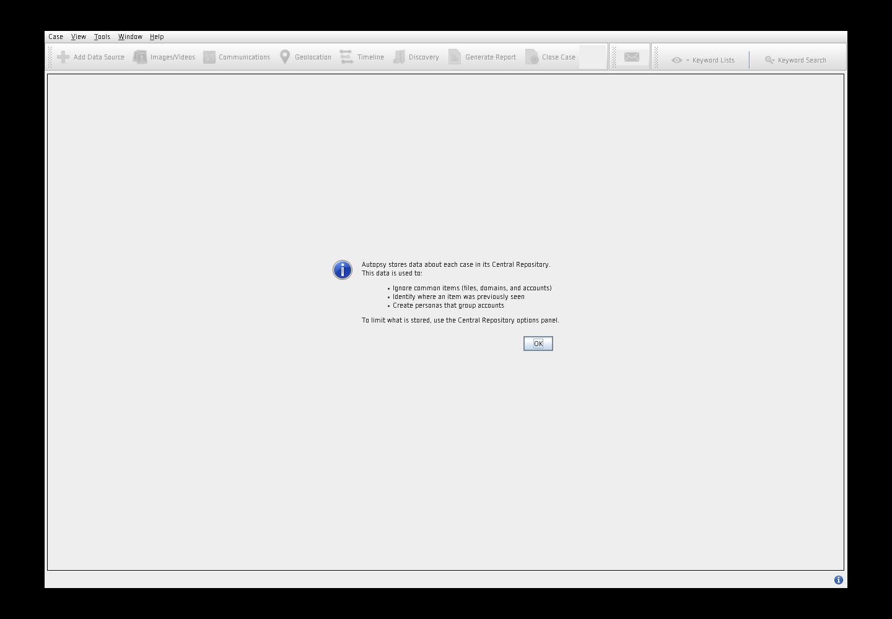

# Autopsy GUI para Linux

Español latinoamericano · [American English](README.md)

Integración independiente de escritorio Linux y empaquetado Debian por **Jan Carlos Herrera Ascanio (Lupo-SysAdmin)**.

Autopsy **4.23.1**, The Sleuth Kit **4.15.0** y un entorno Java privado Eclipse Temurin **21.0.13+9**. La interfaz gráfica original de Autopsy es desarrollada por el proyecto original. Este repositorio facilita construir, instalar y mantener su distribución Linux; no se atribuye la creación de esa interfaz.

**Estado: experimental.** Consulta los [resultados de validación](docs/VALIDATION.md) para conocer las pruebas realizadas. Kali, Parrot y Ubuntu son plataformas objetivo, no una garantía general de compatibilidad. Esta redistribución binaria es independiente y no es un paquete oficial de Debian, Kali, Parrot o Ubuntu.

## Instalación

Descarga el `.deb` y `SHA256SUMS` desde una release de este repositorio. El enlace se agregará cuando se publique. Compara el hash del paquete con el manifiesto de la release y ejecuta:

```bash
sudo apt install ./autopsy-gui_4.23.1-1_amd64.deb
autopsy-gui
```

También puedes abrir **Autopsy GUI** desde el menú de aplicaciones. APT instala las dependencias declaradas; se necesita conexión si faltan en tu equipo. El Java privado no cambia el Java predeterminado del sistema. El paquete no reemplaza el comando `autopsy` antiguo de Kali. Ejecuta la aplicación con tu usuario normal.

```bash
autopsy-gui --version
autopsy-gui --diagnose
sudo apt remove autopsy-gui
```

La configuración se guarda en `${XDG_DATA_HOME:-~/.local/share}/autopsy-gui` y la caché en `${XDG_CACHE_HOME:-~/.cache}/autopsy-gui`. Tú eliges dónde guardar los casos. Desinstalar el paquete no borra casos ni configuración personal. El máximo de memoria Java predeterminado es 4 GB; puedes ajustar `AUTOPSY_GUI_HEAP=8G`. Para solicitar español: `autopsy-gui --locale es` (la traducción depende de Autopsy).

## Construcción

En un equipo Linux con Docker disponible para tu usuario:

```bash
docker build -t autopsy-gui-builder -f packaging/Dockerfile .
docker run --rm -v "$PWD:/work" autopsy-gui-builder
```

Los resultados quedan en `dist/`: `.deb`, manifiesto SHA-256, versiones fijadas y archivos de código fuente correspondientes a TSK y Java. Los archivos generados por Docker pueden pertenecer a root. No subas `.cache/`, `build/` ni `dist/` al historial Git; publica los resultados como adjuntos de una release. Reserva varios GB de disco y conexión para la primera construcción.

Los scripts verifican hashes SHA-256 fijados antes de extraer las descargas. TSK/JNI se compila desde el código oficial; el JAR Java correspondiente proviene del ZIP oficial de Autopsy. Los repositorios del sistema operativo no están fijados a snapshots, por lo que no se afirma reproducibilidad idéntica bit por bit.

Consulta [arquitectura y publicación](docs/BUILD.md), [créditos y licencias](THIRD_PARTY.md) y [validación](docs/VALIDATION.md).

## Alcance

- Escritorios Linux amd64 en esta primera etapa.
- Sin Wine, sin reemplazar el Java del sistema y sin requerir root para la interfaz.
- Se excluyen ejecutables y DLL de Windows; el paquete incluye un inventario de lo retirado.
- No se promete paridad con Windows: upstream documenta limitaciones en Recent Activity, LEAPP, HEIF y miniaturas de video.
- El registro de inicio también informa que falta el componente nativo OpenCV 2.4.13; no se anuncia detección de rostros funcional ni validada.
- Instalar Tesseract/GStreamer no prueba por sí solo el funcionamiento de sus módulos. Verifica los módulos con evidencias conocidas antes de utilizarlos en una investigación.

## Créditos

**Desarrollador y mantenedor de la integración Linux:** Jan Carlos Herrera Ascanio — [Lupo-SysAdmin](https://github.com/Lupo-SysAdmin).

**Aplicación, interfaz y motor forense originales:** Brian Carrier, Sleuth Kit Labs y colaboradores de Autopsy/The Sleuth Kit. **Java:** Eclipse Adoptium/Temurin y colaboradores de OpenJDK. Integración original bajo Apache-2.0; cada componente conserva su licencia. Consulta [NOTICE](NOTICE) y [THIRD_PARTY.md](THIRD_PARTY.md).

Fuentes oficiales: [Autopsy](https://github.com/sleuthkit/autopsy/releases/tag/autopsy-4.23.1), [instrucciones Linux](https://github.com/sleuthkit/autopsy/blob/autopsy-4.23.1/Running_Linux_OSX.md), [TSK](https://github.com/sleuthkit/sleuthkit/releases/tag/sleuthkit-4.15.0).


