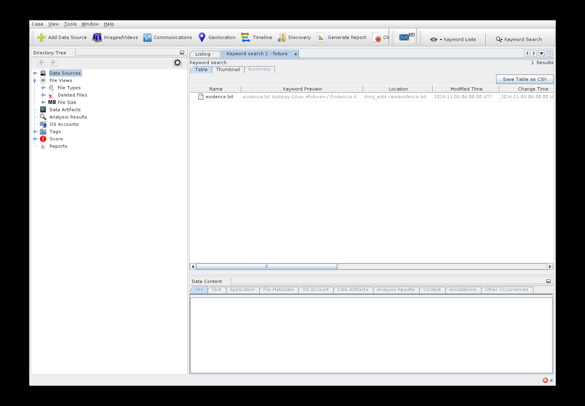

# Autopsy GUI for Linux

[Español latinoamericano](README.es.md) · American English

Independent Linux desktop integration and Debian packaging by **Jan Herrera (Lupo-SysAdmin)**.

Autopsy **4.23.1**, The Sleuth Kit **4.15.0**, and a private Eclipse Temurin **21.0.13+9** runtime. The original Autopsy graphical interface is developed by the upstream project. This repository makes its Linux distribution easier to build, install, and maintain; it does not claim to have created that interface.

**Status: revision 4 validation in progress.** See [validation results](docs/VALIDATION.md) and the module limitations below. This is an independent binary redistribution, not an official Debian/Kali/Parrot/Ubuntu package.

## Install

Download the `.deb` and `SHA256SUMS` from [GitHub Releases](https://github.com/Lupo-SysAdmin/Autopsy-GUI-Linux/releases). Check the package's checksum against the release manifest, then:

```bash
sudo apt install ./autopsy-gui_4.23.1-4_amd64.deb
autopsy-gui
```

You can also open **Autopsy GUI** from your application menu. APT installs declared system dependencies; network access is needed if they are not already installed. The private Java runtime does not change the system's default Java. The package does not replace Kali's legacy `autopsy` command. Run the application as a regular user.

```bash
autopsy-gui --version
autopsy-gui --diagnose
sudo apt remove autopsy-gui
```

User settings are in `${XDG_DATA_HOME:-~/.local/share}/autopsy-gui`; cache is in `${XDG_CACHE_HOME:-~/.cache}/autopsy-gui`. Case locations are chosen by the user. Removal does not delete cases or user settings. Default maximum heap is 4 GB; set `AUTOPSY_GUI_HEAP=8G` when appropriate. To request Spanish, launch `autopsy-gui --locale es` (translations depend on upstream).

New profiles disable the Windows-only aLEAPP, iLEAPP and YARA modules. Existing profiles are preserved; if upgrading from revision 1, uncheck these three modules in Configure Ingest and Run Ingest Modules. Solr stores its logs and PID files in the user profile and listens on localhost. See [test instructions](docs/TESTING.md) and the [redistribution record](docs/REDISTRIBUTION-REVIEW.md).

## Build

On a Linux machine with Docker available to your account:

```bash
docker build -t autopsy-gui-builder -f packaging/Dockerfile .
docker run --rm -v "$PWD:/work" autopsy-gui-builder
```

The output is in `dist/`: `.deb`, SHA-256 manifest, pinned versions, and corresponding source archives for TSK, the Java runtime, and additional third-party libraries. Container output may be owned by root. Never commit `.cache/`, `build/`, or `dist/` to Git. Upload release artifacts instead. Allow several GB of disk space and internet access for the first build.

The scripts verify fixed upstream SHA-256 hashes before extraction. The native TSK/JNI layer is compiled from the official source archive; the matching Java JAR comes from the official Autopsy ZIP. Build package versions are recorded in the build environment; OS repositories are not snapshot-pinned, so bit-for-bit reproducibility is not claimed.

See [architecture and release process](docs/BUILD.md), [credits and licensing](THIRD_PARTY.md), and [validation](docs/VALIDATION.md).

## Scope

- amd64 desktop Linux only in this first iteration.
- No Wine, system Java replacement, or root requirement for the GUI.
- Windows executables and DLLs are excluded; removal inventory is shipped in the package.
- No claim that all Windows modules work on Linux. Upstream documents limitations in Recent Activity, LEAPP, HEIF, and video thumbnails.
- The startup log also reports missing OpenCV 2.4.13 native support; face-detection functionality is not validated or advertised as working.
- Tesseract/GStreamer installation alone does not prove every associated ingest module works. Validate modules against known evidence before investigative use.

## Credits

**Linux integration developer and maintainer:** Jan Herrera — [Lupo-SysAdmin](https://github.com/Lupo-SysAdmin).

**Original application, interface, and forensic engine:** Brian Carrier, Sleuth Kit Labs, Autopsy/The Sleuth Kit contributors. **Runtime:** Eclipse Adoptium/Temurin and OpenJDK contributors. Original integration code: Apache-2.0. Third-party software retains its own licenses; see [NOTICE](NOTICE) and [THIRD_PARTY.md](THIRD_PARTY.md).

Official sources: [Autopsy release](https://github.com/sleuthkit/autopsy/releases/tag/autopsy-4.23.1), [Linux instructions](https://github.com/sleuthkit/autopsy/blob/autopsy-4.23.1/Running_Linux_OSX.md), [TSK release](https://github.com/sleuthkit/sleuthkit/releases/tag/sleuthkit-4.15.0).


